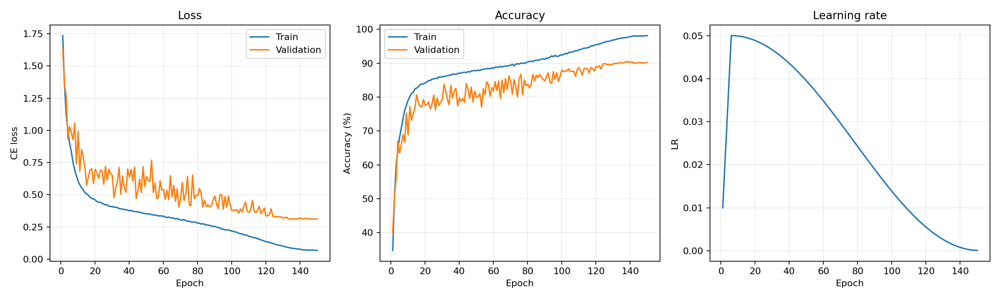
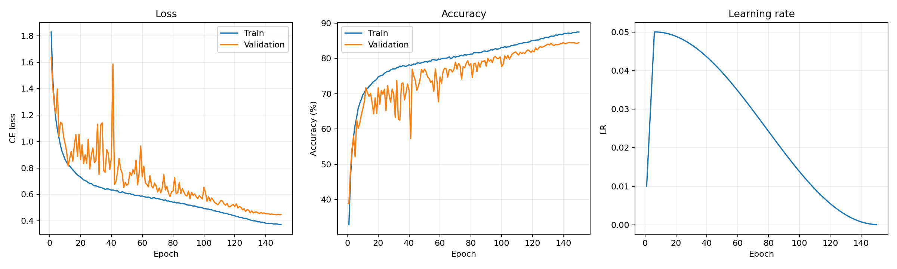

# CIFAR-10 소형 CNN 학습 및 INT8 PTQ

PyTorch를 이용해 CIFAR-10 10-class 이미지 분류용 소형 CNN 두 가지를 구현하고, 학습이 끝난 FP32 모델에 **Post-Training Quantization (PTQ)** 을 적용해 INT8 모델로 변환한 프로젝트입니다.

## 프로젝트 개요

이 프로젝트는 두 가지 경량 CNN을 비교합니다.

- **SmallResNet**: Residual connection을 사용하는 소형 CNN. 3개의 residual block과 32→32→64→128 채널 구성을 사용합니다.
- **DS-Compact**: Depthwise convolution과 pointwise convolution을 결합한 3개의 depthwise-separable block으로 구성된 초경량 CNN입니다.

두 모델은 CIFAR-10의 32×32 입력에 맞춰 구현한 프로젝트용 변형 구조이며, ResNet/MobileNet 계열의 설계 원리를 참고했습니다.

## 주요 결과

### FP32 및 INT8 비교

아래 결과는 저장소에 포함된 실험 산출물(`results/`)을 기준으로 합니다. INT8은 PyTorch Static PTQ로 변환했습니다.

| 항목 | SmallResNet | DS-Compact |
|---|---:|---:|
| 학습 파라미터 수 | 308,650 | 31,946 |
| Best validation accuracy | 90.44% | 84.54% |
| FP32 test accuracy | 90.41% | 83.77% |
| INT8 test accuracy | 90.25% | 83.32% |
| Accuracy drop | 0.16%p | 0.45%p |
| FP32 TorchScript size | 1.184 MiB | 0.127 MiB |
| INT8 TorchScript size | 0.323 MiB | 0.054 MiB |
| File-size reduction | 72.72% | 57.44% |
| FP32 CPU latency (batch 1) | 1.937 ms | 0.475 ms |
| INT8 CPU latency (batch 1) | 1.395 ms | 0.248 ms |
| INT8 speedup | 1.39× | 1.92× |

**해석:** SmallResNet은 더 높은 분류 정확도와 큰 파일 크기 감소율을 보였습니다. DS-Compact은 절대 파일 크기와 CPU 지연 시간이 더 작았습니다. 따라서 정확도 우선의 선택과 모델 크기·지연 시간 우선의 선택 사이에 trade-off가 있음을 확인할 수 있습니다.

> CPU latency는 x86 양자화 backend, CPU thread 1개, batch size 1에서 측정한 모델 forward 시간입니다. Warm-up 이후 반복 측정한 값이며 데이터 로딩과 이미지 전처리 시간은 포함하지 않았습니다.

### 학습 곡선

**SmallResNet**



**DS-Compact**



각 그림에는 Train/Validation loss, Train/Validation accuracy, learning-rate schedule이 포함되어 있습니다. Epoch별 상세 이력은 각각의 `*_history.json` 파일에 저장되어 있습니다.

### 클래스별 정확도 변화

전체 정확도 변화만으로는 PTQ의 영향을 모두 설명할 수 없기 때문에 클래스별 FP32/INT8 정확도도 저장했습니다. 예를 들어 DS-Compact은 INT8 변환 후 Dog에서 4.9%p, Frog에서 3.9%p의 정확도 감소를 보였지만, Cat과 Bird에서는 각각 2.5%p, 2.3%p 개선되었습니다. 이는 클래스별 변화가 균일하지 않을 수 있음을 보여줍니다.

클래스별 전체 비교는 [`ptq_classwise_comparison.csv`](results/results_ptq_sgd_additional_cifar_stats/ptq_classwise_comparison.csv)를 참고하세요. `accuracy_drop_pp`는 FP32 정확도에서 INT8 정확도를 뺀 값이며, 양수는 감소, 음수는 해당 클래스에서 INT8 정확도가 더 높았음을 의미합니다.

## 저장소 구성

```text
cifar10-ptq/
├── notebooks/
│   └── cifar10_cnn.ipynb
├── report/
│   └── CNN report.pdf
├── results/
│   ├── results_sgd_additional_cifar_stats/
│   │   ├── small_resnet_curves.png
│   │   ├── ds_compact_curves.png
│   │   ├── small_resnet_history.json
│   │   ├── ds_compact_history.json
│   │   ├── training_summary.csv
│   │   └── experiment_config.json
│   └── results_ptq_sgd_additional_cifar_stats/
│       ├── ptq_comparison.csv
│       └── ptq_classwise_comparison.csv
├── requirements.txt
├── .gitignore
└── README.md
```

- `notebooks/cifar10_cnn.ipynb`: 데이터 준비, 모델 정의, 학습, FP32 평가, Calibration, INT8 변환, CPU benchmark를 수행하는 메인 노트북입니다.
- `report/CNN report.pdf`: 프로젝트 분석 보고서입니다.
- `results/`: 현재 보고서에 사용한 학습 곡선, 학습 이력, 설정 및 성능 비교 결과입니다.
- `requirements.txt`: Python 패키지 버전 목록입니다.

체크포인트와 변환된 모델 파일은 저장소에 포함하지 않았습니다. 전체 노트북을 실행하면 학습 및 PTQ 과정에서 생성됩니다.

## 실행 방법

### 1. 환경 준비

Python 3.10 환경을 권장합니다. 저장소를 clone하고 프로젝트 루트 디렉터리에서 가상환경을 만듭니다.

```bash
git clone https://github.com/twkang1104/cifar10-ptq.git
cd cifar10-ptq
python -m venv .venv
```

가상환경 활성화:

```bash
# Windows PowerShell
.venv\Scripts\Activate.ps1

# Linux / macOS
source .venv/bin/activate
```

### 2. PyTorch 설치

사용 중인 환경에 맞춰 **아래 두 방법 중 하나만** 선택합니다. CUDA가 설치된 GPU 환경에서는 PyTorch 공식 설치 안내에 맞는 CUDA wheel을 사용하세요. 다음은 실험에 사용한 PyTorch 2.5.1 / TorchVision 0.20.1 조합의 예시입니다.

```bash
# NVIDIA GPU, CUDA 12.1 wheel 예시
pip install torch==2.5.1 torchvision==0.20.1 --index-url https://download.pytorch.org/whl/cu121
```

```bash
# CPU-only 환경
pip install torch==2.5.1 torchvision==0.20.1 --index-url https://download.pytorch.org/whl/cpu
```

그 다음 나머지 의존성과 JupyterLab을 설치합니다.

```bash
pip install -r requirements.txt
pip install jupyterlab
```

### 3. 데이터 다운로드 및 노트북 실행

노트북에서 CIFAR-10 데이터 경로는 `./data`로 설정합니다. `torchvision.datasets.CIFAR10(..., download=True)` 설정을 사용하므로 **별도로 데이터셋을 다운로드하거나 GitHub에 업로드할 필요가 없습니다.** 첫 실행 시 인터넷 연결을 통해 CIFAR-10이 `data/` 아래 자동으로 다운로드됩니다. 이후 실행에서는 이미 받은 데이터를 재사용합니다.

프로젝트 루트에서 JupyterLab을 실행합니다.

```bash
jupyter lab
```

브라우저에서 `notebooks/cifar10_cnn.ipynb`를 열고 위에서부터 순서대로 모든 셀을 실행합니다. 노트북은 모델을 먼저 학습한 다음, 저장된 best-validation checkpoint를 사용해 FP32 평가와 INT8 PTQ를 진행합니다. 

### 4. GPU 및 CPU 실행

코드가 `torch.cuda.is_available()`를 확인해 CUDA를 사용할 수 있으면 기본 GPU(`cuda:0`)를 사용하고, CUDA를 사용할 수 없으면 CPU로 실행합니다. 여러 GPU가 있다고 해서 자동으로 다중 GPU 학습을 수행하는 것은 아니며, 기본적으로 첫 번째 visible GPU 하나를 사용합니다.

- **CUDA GPU 환경:** 학습을 빠르게 수행할 수 있습니다. 실제 CUDA 사용 여부는 노트북 출력의 `Device`와 `GPU` 항목에서 확인할 수 있습니다.
- **CPU-only 환경:** 학습과 PTQ 실행이 가능합니다. 다만 두 모델을 각각 150 epoch 학습하므로 GPU 환경보다 훨씬 오래 걸릴 수 있습니다. CPU에서는 AMP가 자동으로 비활성화됩니다.
- **DataLoader 문제 발생 시:** 일부 Windows/Jupyter 환경에서 worker 프로세스 문제가 발생하면 노트북의 `NUM_WORKERS`, `VAL_WORKERS`를 `0`으로 설정해 실행할 수 있습니다.

### 5. 실행 설정

기본 실험 설정은 다음과 같습니다.

| 설정 | 값 |
|---|---|
| Dataset | CIFAR-10 |
| Input size | 32 × 32 × 3 |
| Train / Validation / Test | 45,000 / 5,000 / 10,000 |
| Batch size | 128 |
| Epochs | 150 per model |
| Optimizer | SGD + momentum 0.9 + Nesterov |
| Initial learning rate | 0.05 |
| Weight decay | 0.0005 |
| Scheduler | 5-epoch linear warm-up + cosine annealing |
| Augmentation | RandomCrop(32, padding=4), RandomHorizontalFlip(0.5) |
| Calibration | 2,050 training images (205 per class) |
| Quantization | Static INT8 PTQ, x86 backend |

## 결과 파일

노트북은 실행한 작업 디렉터리를 기준으로 다음 폴더를 생성합니다.

```text
checkpoints_sgd_additional_cifar_stats/
checkpoints_int8_sgd_additional_cifar_stats/
checkpoints_torchscript_sgd_additional_cifar_stats/
results_sgd_additional_cifar_stats/
results_ptq_sgd_additional_cifar_stats/
```

GitHub의 `results/` 아래에 저장된 CSV와 그래프는 보고서에 사용한 기존 실행 결과를 보존한 파일입니다. 새로 실행하면 위 경로에 별도의 결과 폴더가 생성되며, 이 구조가 GitHub에 저장된 결과 폴더 구조와 반드시 같을 필요는 없습니다.

주요 결과 파일:

- `training_summary.csv`: 모델별 파라미터 수, best epoch, validation accuracy/loss, 학습 시간
- `*_history.json`: epoch별 train/validation loss와 accuracy, learning rate
- `*_curves.png`: 학습 곡선 이미지
- `ptq_comparison.csv`: FP32/INT8 정확도, 파일 크기, CPU 지연 시간 및 speedup
- `ptq_classwise_comparison.csv`: 클래스별 FP32/INT8 정확도와 차이
- `experiment_config.json`: 학습 및 실험 설정

## 한계 및 해석 시 유의점

- 이번 실험은 x86 CPU에서 수행한 추론 벤치마크로, 실제 모바일·임베디드 기기에서의 배포 성능을 측정한 것은 아니다.
- CPU 지연 시간은 CPU 모델, 운영체제, PyTorch 빌드와 thread 설정에 따라 달라질 수 있다. 
- 학습에는 seed와 고정된 stratified split을 사용했지만, GPU kernel 설정이 완전한 deterministic 모드가 아니므로 하드웨어나 실행 환경에 따라 결과가 약간 달라질 수 있다.

## 참고 자료

- He, K. et al. “Deep Residual Learning for Image Recognition.” CVPR, 2016. [Paper](https://openaccess.thecvf.com/content_cvpr_2016/html/He_Deep_Residual_Learning_CVPR_2016_paper.html)
- Howard, A. et al. “MobileNets: Efficient Convolutional Neural Networks for Mobile Vision Applications.” 2017. [arXiv](https://arxiv.org/abs/1704.04861)
- PyTorch, [Quantization documentation](https://docs.pytorch.org/docs/stable/quantization-support.html)
